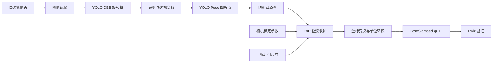

# 新生视觉入门任务：从摄像头到 ROS 2 TF

参考项目：**[ARES-Algorithm/kfs_alignment](https://github.com/ARES-Algorithm/kfs_alignment)**。本仓库保存学习任务文档，源码与模型位于参考项目中。

> 参考项目为私有仓库，学习前需联系项目维护者获得读取权限；能访问本文档不代表自动获得参考项目权限。

> 目标：自主选用一台摄像头，完成目标检测、三维位姿估计，并在 ROS 2 中发布目标 TF，在 RViz 中验证结果。
> 本任务到 TF 为止，不要求底盘控制、PID、抬升机构、IMU 融合或机器人运动。

这份文档以本仓库为参考实现。可以先运行现有代码理解数据流，再完成自己的实现与实验记录。验收既看程序结果，也看能否解释结果从哪里来。

## 1. 最终需要做出什么

把一个已知尺寸的目标放在相机前，程序应当：

1. 实时读取图像，显示检测框和四个有固定顺序的角点。
2. 利用相机内参、畸变参数及目标尺寸，通过 PnP 求出位姿。
3. 发布 `geometry_msgs/msg/PoseStamped` 和动态 TF。
4. 在 RViz 中显示目标坐标轴，移动目标时坐标变化方向正确。
5. 用实测数据说明距离误差、静止抖动和有效输出频率。

本仓库的基本处理链如下：



学习时可以先手动指定一张图片上的四角点，验证 PnP，再接入模型。手动点选只能作为阶段练习，最终实时演示需要自动检测。

## 2. 摄像头自行选择

不限定海康，不要求购买与原作者相同的设备。优先使用手头已有、能够稳定取图的相机；确定驱动、分辨率和曝光能满足任务后，再考虑更换硬件。

| 相机接入方式 | 本仓库对应配置 | 需要完成的工作 |
| --- | --- | --- |
| USB 摄像头或电脑内置摄像头 | `input.mode: usb` | 用 OpenCV 取图，确认设备号与实际分辨率 |
| 能发布 ROS 图像的相机 | `input.mode: topic` | 启动厂商或自写驱动，确认图像话题与编码 |
| 海康工业相机 | `input.mode: hikvision` | 安装 MVS SDK，验证 SDK 取图 |
| 其他 SDK 相机 | 自写 ROS 图像发布节点，再用 `topic` | 把 SDK 图像转换为 `sensor_msgs/msg/Image` |

选择时记录：相机型号、接口、驱动、实际分辨率、帧率、是否自动对焦、是否能控制曝光。使用深度相机也可以，但本任务只需要彩色图像，仍要完成单目 PnP 流程。

**换相机后必须重新标定。** 改分辨率、裁剪图像或改变焦距，也要重新确认内参是否有效。不要直接沿用仓库里的海康标定数据。尽量固定焦距，避免自动对焦持续改变成像参数。

## 3. 先补齐这些基础

不要求先学完全部机器人课程。遇到下面的内容时，能解释并做一个小实验即可。

| 基础 | 最小练习 |
| --- | --- |
| Linux、Git、Python | 克隆仓库、创建分支、运行脚本、定位报错行 |
| NumPy、OpenCV | 读取图像、查看宽高、绘制四个点、打开相机 |
| ROS 2 | 创建节点，发布与订阅消息，使用 `topic echo` 和参数 |
| 相机模型 | 解释 `fx/fy/cx/cy`、畸变、像素坐标和空间坐标 |
| 刚体变换 | 理解旋转矩阵、平移、四元数以及变换方向 |
| TF | 解释父坐标系、子坐标系、时间戳与动态变换 |

## 4. 按阶段完成

建议按阶段验收，不限定必须几天完成。卡住时提交最小复现、错误输出和已经排查的结果。

### 阶段 A：相机稳定出图

- 选择相机并跑通最小取图程序。
- 连续运行至少 1 分钟，记录实际宽高、平均帧率以及是否掉帧。
- 保存几张包含目标的原始图片，覆盖不同距离和角度。
- 能解释 BGR/RGB、图像宽高与数组维度的关系。

**交付：** 相机信息、取图脚本或驱动启动命令、原始样例图。

### 阶段 B：完成相机标定

- 使用棋盘格等标定板，准确测量格子尺寸。
- 建议采集 20–30 张清晰图片，覆盖画面中心、边缘、不同距离和倾角；这些数量是练习建议，并非算法硬性要求。
- 计算并保存相机矩阵和畸变系数。
- 查看重投影误差，检查去畸变前后图像，不只抄写一个最终数值。
- 保持标定与推理图像的分辨率、焦距一致。

**交付：** 标定脚本、标定结果、图像分辨率、标定板尺寸、误差记录和示例图。

### 阶段 C：理解并运行检测模型

仓库已经提供两份真实权重，不需要先训练模型：

| 文件 | 约占空间 | 作用 |
| --- | --- | --- |
| [`models/obb/best.pt`](https://github.com/ARES-Algorithm/kfs_alignment/blob/main/src/kfs_alignment/models/obb/best.pt) | 5.6 MB | 在原图中检测目标旋转框 |
| [`models/pose/best.pt`](https://github.com/ARES-Algorithm/kfs_alignment/blob/main/src/kfs_alignment/models/pose/best.pt) | 41 MB | 在变换后的区域中预测四个角点 |

阅读 [`yolo_detector.py`](https://github.com/ARES-Algorithm/kfs_alignment/blob/main/src/kfs_alignment/kfs_alignment/yolo_detector.py) 和 [`geometry_utils.py`](https://github.com/ARES-Algorithm/kfs_alignment/blob/main/src/kfs_alignment/kfs_alignment/geometry_utils.py)，回答：

- 为什么先检测旋转框，再检测角点？
- Pose 模型的角点属于原图还是裁剪后的图像？如何映射回原图？
- 四个角点如何排序，为什么不能任意交换？
- 没有检测到目标时，程序应该输出什么？

**已有模型不等于通用模型。** 更换相机后应先用实际图片验证；更换目标外观后，不保证已有权重仍然适用。无法识别时，先排查成像、目标外观和输入尺寸，再考虑补数据或训练。

若暂时没有对应 KFS 实物，可以经指导者确认，采用已知尺寸的方形标记完成同样的“检测 → PnP → TF”任务。此时需要替换检测部分并定义自己的目标坐标系；不能把任意平面标记直接当成立方体中心来解释。最终报告说明所用路线。

**交付：** 自动检测脚本或节点、带角点编号的图片、成功与失败样例。

### 阶段 D：PnP 求位姿

阅读 [`pnp_solver.py`](https://github.com/ARES-Algorithm/kfs_alignment/blob/main/src/kfs_alignment/kfs_alignment/pnp_solver.py)，完成以下练习：

1. 写出四个角点的物体坐标，并与图像上的点一一对应。
2. 输入相机矩阵、畸变参数、物体点和像素点，求解 `rvec/tvec`。
3. 将物体点投影回图像，叠加显示预测点和检测点，计算像素误差。
4. 分清被观测面的中心与整个立方体的中心：仓库在面位姿基础上加了旋转后的几何偏移。
5. 用卷尺在多个距离验证输出，解释误差来源。

`IPPE_SQUARE` 对四点坐标和顺序有要求，应结合代码与 [OpenCV PnP 文档](https://docs.opencv.org/4.x/d5/d1f/calib3d_solvePnP.html)核对。不要仅为了“能出数值”而乱换点序。

PnP 求的是物体坐标到相机坐标的变换。单目绝对尺度来自已知目标尺寸，尺寸写错会直接影响距离结果。

**交付：** PnP 验证脚本、重投影图片、距离对比表，以及对变换方向的说明。

### 阶段 E：发布 ROS 位姿和 TF

先运行参考节点，随后在自己的实现中发布同样含义的接口：

| 输出 | 消息类型 | 含义 |
| --- | --- | --- |
| `/cube_pose/pose` | `geometry_msgs/msg/PoseStamped` | 目标中心位置（米）与姿态四元数 |
| `/tf` | `tf2_msgs/msg/TFMessage` | 通过 `TransformBroadcaster` 发布目标动态变换 |
| `/cube_pose/visualization` | `sensor_msgs/msg/Image` | 检测及位姿可视化图像 |
| `/cube_pose/face_corners_3d` | `geometry_msgs/msg/PolygonStamped` | 面四角的三维坐标，辅助检查 |
| `/cube_pose/markers` | `visualization_msgs/msg/MarkerArray` | RViz 标记，辅助检查 |

最终必做项是实时自动检测、位姿和动态 TF；辅助话题可按实现保留。参考代码在检测或 PnP 失败时不会发布新的有效目标位姿。TF 缓冲区可能仍保留旧变换，因此看到坐标轴不代表目标仍被检测到，要同时检查时间戳与更新频率。

**交付：** 可运行的 ROS 节点、参数文件、启动方式、RViz 配置和演示录像。

## 5. 跑参考实现：只启动视觉节点

### 环境准备

参考环境为 Ubuntu 24.04、ROS 2 Jazzy、Python 3.12。先按 [ROS 2 Jazzy 官方安装指南](https://docs.ros.org/en/jazzy/Installation/Ubuntu-Install-Debs.html)安装 ROS，再准备项目依赖。

以下命令使用 **Bash**。如果日常终端是 Zsh，可先输入 `bash`，然后执行本节命令。仓库是工作空间根目录，不要再重复套一层 `src/kfs_alignment` 工作空间。

首次开始学习时，先在主目录克隆参考项目（若已克隆则跳过）：

```bash
cd ~
git clone https://github.com/ARES-Algorithm/kfs_alignment.git
```

```bash
cd ~/kfs_alignment
source /opt/ros/jazzy/setup.bash
sudo apt install python3-venv python3-colcon-common-extensions python3-rosdep
rosdep install --from-paths src --ignore-src --rosdistro jazzy -r -y
```

若提示 rosdep 尚未初始化，先按提示完成 `sudo rosdep init` 和 `rosdep update`，再重试。若工作空间不是克隆到 `~/kfs_alignment`，相应修改路径。

使用系统 Python 创建虚拟环境，让它能读取系统安装的 ROS Python 包；避免直接覆盖系统 Python 环境：

```bash
/usr/bin/python3 -m venv --system-site-packages .venv
source .venv/bin/activate
touch .venv/COLCON_IGNORE
python -m pip install ultralytics scipy
python -c "import rclpy, cv2, torch, ultralytics, scipy; print('imports OK')"
```

首次安装记录实际依赖版本。GPU/CUDA 加速不是本次任务的前置要求，先用 CPU 验证链路。若依赖导入失败，先解决该步骤，不要带着错误继续编译。

### 创建自己的参数文件

```bash
mkdir -p local_config
cp src/kfs_alignment/config/cube_pose_estimator.yaml local_config/student.yaml
```

编辑 `local_config/student.yaml`，保留外层节点名和 `ros__parameters`。下面是需要调整的部分，**不要用它覆盖完整文件**：

```yaml
cube_pose_estimator:
  ros__parameters:
    input:
      mode: "usb"
    usb:
      camera_id: 0
      width: 640
      height: 480
      fps: 30.0
      auto_exposure: true
    yolo:
      obb_model_path: "/home/你的用户名/kfs_alignment/src/kfs_alignment/models/obb/best.pt"
      pose_model_path: "/home/你的用户名/kfs_alignment/src/kfs_alignment/models/pose/best.pt"
      device: "cpu"
    frame_ids:
      camera_frame: "rgb_camera_link"
      cube_center_frame: "cube_center"
    publish:
      pose: true
      tf: true
      visualization: true
      face_corners_3d: true
      markers: true
```

另外必须更新：

- `camera.intrinsics`：本机相机标定得到的 `fx/fy/cx/cy`。
- `camera.distortion`：与输入图像匹配的畸变参数。
- `target.cube_size_mm`：实际立方体边长，单位 mm。
- 图像尺寸：示例的 640×480 只是取图起点，必须确认设备实际支持，并用该尺寸标定。仓库原配置的 USB 宽度为 128，不能盲目沿用。
- 模型路径：写真实绝对路径，YAML 中的 `~` 或 `$HOME` 不应假设会被自动展开。

用 ROS 图像输入时，将 `input.mode` 改为 `topic`，并设置 `image_topic`。当前节点从 YAML 读取内参，**不会自动订阅 `CameraInfo` 更新标定**。若驱动输出的是已去畸变图像，应使用该图像对应的内参和畸变约定，避免重复去畸变；也要检查图像编码、时间戳和 QoS 是否匹配。

### 编译并启动

在前面已激活虚拟环境的同一终端执行：

```bash
python /usr/bin/colcon build --symlink-install --packages-select kfs_alignment
source install/setup.bash
ros2 run kfs_alignment cube_pose_node --ros-args \
  -r __node:=cube_pose_estimator \
  --params-file "$PWD/local_config/student.yaml" \
  -p use_grayscale:=false
```

此处显式指定节点名，确保能匹配 YAML 的 `cube_pose_estimator` 参数块。灰度模式可在基础链路运行后作为对比实验。

**本任务不要使用 `kfs_align.launch.py` 作为启动入口**：它还会启动底盘控制节点。`cube_pose_estimator_with_fusion.launch.py` 会额外启动融合节点，也不是本任务必需。上述 `ros2 run` 只运行视觉节点。

### 查看 ROS 输出

每个新终端都先加载环境：

```bash
bash
cd ~/kfs_alignment
source /opt/ros/jazzy/setup.bash
source .venv/bin/activate
source install/setup.bash
```

然后按需执行以下命令，持续输出的命令用 `Ctrl+C` 结束：

```bash
ros2 node list
ros2 topic list
ros2 topic echo /cube_pose/pose --once
ros2 topic hz /cube_pose/pose
ros2 run tf2_ros tf2_echo rgb_camera_link cube_center
```

检测不到目标时，`echo --once` 可能持续等待。相机帧率、模型推理帧率与有效位姿发布频率不是同一个指标，要分别理解。

启动 RViz：

```bash
rviz2
```

在 RViz 中：

1. 将 **Fixed Frame** 设置为 `rgb_camera_link`。
2. 添加 **TF**，查看 `cube_center` 坐标轴。
3. 添加 **Image**，选择 `/cube_pose/visualization`。
4. 需要时添加 **MarkerArray**，选择 `/cube_pose/markers`。

## 6. 坐标系必须讲明白

OpenCV 相机光学坐标一般为右、下、前；本仓库发布前转换成 FLU：前、左、上。

```text
OpenCV optical：x 向右，y 向下，z 向前
本仓库 FLU：   x 向前，y 向左，z 向上

x_flu =  z_optical
y_flu = -x_optical
z_flu = -y_optical
```

旋转也要一起变换，不能只改平移分量。仓库先把毫米转换成米，再发布位置；四元数消息字段顺序为 `x, y, z, w`。

本任务最小 TF 树：

```text
rgb_camera_link  （相机位置为原点，FLU 轴向）
└── cube_center  （立方体中心与物体姿态）
```

没有机器人底座也能完成本任务，不必凭空增加 `map`、`odom` 或 `base_link`。若相机驱动已有同名 TF，必须检查原点和轴向是否相同；含义不同就换一个明确的名字，并同步修改查询命令和 RViz Fixed Frame。单纯改 `frame_id` 字符串不会改变坐标值。

这里的目标相对相机会移动，应发布动态 TF；不能用静态广播器伪装实时估计。一个子坐标系应有明确的父坐标系和发布来源，避免两个节点同时发布相互冲突的变换。

验证平移时，相机保持固定：目标远离镜头，X 应增大；向相机左侧移动，Y 应增大；向上移动，Z 应增大。旋转时根据自己定义的物体坐标轴检查姿态，不要默认正对相机时四元数一定为单位四元数，也不要照搬控制节点里的 yaw 补偿。

## 7. 验收与提交

以下是学习任务建议的验收办法，不是对现有模型精度的承诺。指导者可以结合相机、目标大小和实验场地约定数值阈值。

### 必须通过

- [ ] 从新终端按 README 能启动，依赖、参数和设备信息齐全。
- [ ] 使用自选相机，并提交与当前分辨率匹配的标定结果。
- [ ] 能自动检测目标，显示四个角点及其编号。
- [ ] 能解释 PnP 输入、角点对应关系、物体原点和输出变换方向。
- [ ] 发布有效 `PoseStamped` 与动态 TF，二者时间戳、位置和姿态一致。
- [ ] RViz 可见目标坐标轴，平移方向符合约定，位置单位为米。
- [ ] 目标离开视野后，不把缓存中的旧 TF 解释成新的检测结果。
- [ ] 启动流程中没有底盘、抬升或 IMU 融合节点。

### 实验记录

至少选择 3 个适合当前镜头和目标的距离，每个距离固定相机与目标采集约 10 秒；另测倾斜角度、画面边缘和一次短暂遮挡。测量参考应对应相机光心到目标中心；若使用外壳作为近似参考，要写明偏移和测量局限。

| 工况 | 实测距离 m | 平均估计距离 m | 绝对误差 m | 位置标准差 m | 有效位姿 Hz | 现象与原因分析 |
| --- | --- | --- | --- | --- | --- | --- |
| 近距离正面 | 待测 | 待测 | 待测 | 待测 | 待测 | 待记录 |
| 中距离正面 | 待测 | 待测 | 待测 | 待测 | 待测 | 待记录 |
| 远距离正面 | 待测 | 待测 | 待测 | 待测 | 待测 | 待记录 |
| 倾斜 / 边缘 / 遮挡 | 待测 | 待测 | 待测 | 待测 | 待测 | 待记录 |

比较同一种量：若卷尺测前向深度就与 X 比较；若测空间直线距离就与位置向量的模比较。可以记录 XYZ 各分量标准差。不要用重投影像素误差代替实际空间测量误差。

### 最终提交内容

在自己的分支或课程指定仓库提交：

1. 源码、配置文件、启动命令和依赖版本。
2. 相机型号、输入方式、分辨率及标定报告。
3. 目标尺寸、角点顺序图和坐标系示意图。
4. 上表的实测结果，以及至少一个失败案例分析。
5. 一段演示录像：原图/检测结果、RViz 坐标轴和 TF 数值同时可核对。
6. 简短说明：复用了哪些代码、自己实现了什么、尚有哪些限制。

提交前清理本地绝对路径和无关生成文件；大型原始数据按课程约定保存。不要只交一段“跑起来了”的视频。

## 8. 常见问题

| 现象 | 优先检查 |
| --- | --- |
| 找不到模型 | 是否仍使用 `/home/gsp/...`，文件是否真实存在，参数块是否匹配节点名 |
| 相机打不开 | 设备号、驱动、权限、设备是否被其他程序占用 |
| 图像有但没有检测 | 目标是否匹配训练外观、清晰度、曝光、缩放和模型输入 |
| 四点正确但距离明显不对 | 相机内参、图像分辨率、目标尺寸、mm/m、面中心与体中心区别 |
| 姿态翻转或跳变 | 点序对应、平面 PnP 歧义、目标太小、模糊与遮挡 |
| 位姿数字有但 RViz 报错 | Fixed Frame、TF 父子名称、时间戳、是否真的发布新 TF |
| 左右或上下反了 | optical 到 FLU 的转换是否遗漏或重复 |
| ROS 图像话题存在但收不到 | 实际编码、话题名、QoS 兼容性，使用 `ros2 topic info -v` 检查 |
| 看见旧 TF 但目标已移走 | 检查时间戳和更新频率，TF 缓存不代表持续检测成功 |

## 9. 推荐阅读顺序

先读本仓库：

1. [`yolo_detector.py`](https://github.com/ARES-Algorithm/kfs_alignment/blob/main/src/kfs_alignment/kfs_alignment/yolo_detector.py)：两阶段检测。
2. [`geometry_utils.py`](https://github.com/ARES-Algorithm/kfs_alignment/blob/main/src/kfs_alignment/kfs_alignment/geometry_utils.py)：图像变换与角点映射。
3. [`pnp_solver.py`](https://github.com/ARES-Algorithm/kfs_alignment/blob/main/src/kfs_alignment/kfs_alignment/pnp_solver.py)：几何模型与位姿求解。
4. [`cube_pose_node.py`](https://github.com/ARES-Algorithm/kfs_alignment/blob/main/src/kfs_alignment/kfs_alignment/cube_pose_node.py)：输入接入、坐标转换和 ROS 发布。
5. [`cube_pose_estimator.yaml`](https://github.com/ARES-Algorithm/kfs_alignment/blob/main/src/kfs_alignment/config/cube_pose_estimator.yaml)：参数与实际行为的对应关系。

再结合官方材料做小实验：

- [ROS 2 Jazzy 教程](https://docs.ros.org/en/jazzy/Tutorials.html)
- [tf2 入门](https://docs.ros.org/en/jazzy/Tutorials/Intermediate/Tf2/Introduction-To-Tf2.html)
- [Python 动态 TF 广播器](https://docs.ros.org/en/jazzy/Tutorials/Intermediate/Tf2/Writing-A-Tf2-Broadcaster-Py.html)
- [OpenCV 相机标定](https://docs.opencv.org/4.x/dc/dbb/tutorial_py_calibration.html)
- [OpenCV PnP](https://docs.opencv.org/4.x/d5/d1f/calib3d_solvePnP.html)

完成后应能独立回答：**图像上的四个点，为什么能变成 TF 中一个有单位、有方向、有时间戳的三维坐标系？**
